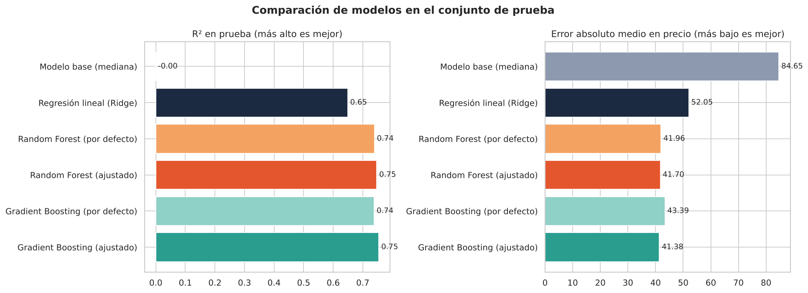
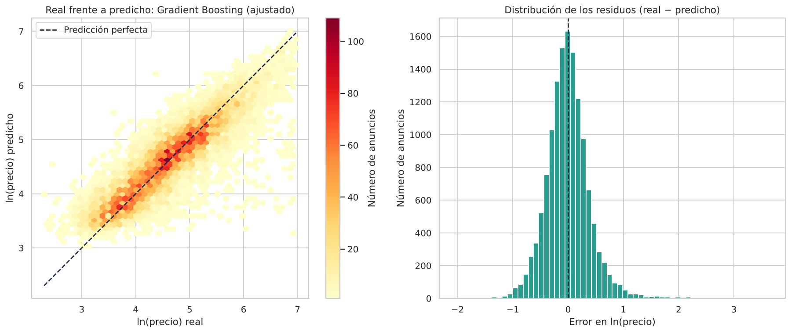
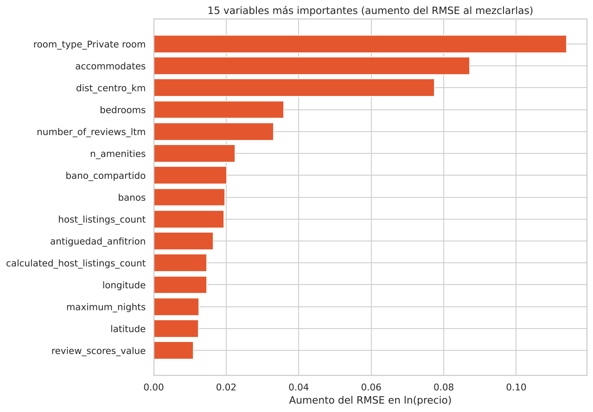

# Predicción del precio de alojamientos de Airbnb en Londres

Proyecto aplicado del **Diplomado en Analítica de Datos** (Corporación Universitaria Minuto de Dios, Uniminuto), desarrollado con la metodología **CRISP-DM**.

[](https://colab.research.google.com/github/USUARIO/NOMBRE-DEL-REPOSITORIO/blob/main/notebooks/Proyecto_CRISP-DM_Airbnb_Londres_Colab_Fase5_CSV.ipynb)

> Para que el botón funcione, reemplaza `USUARIO` y `NOMBRE-DEL-REPOSITORIO` en el enlace por tu usuario de GitHub y el nombre de este repositorio.

| | |
|---|---|
| **Autora** | Jineth Valentina Díaz Romero (ID 866956) |
| **Docente** | Xammy Alexander Victoria Gonzalez |
| **NRC** | 86-1635 |
| **Datos** | [Detailed Airbnb Listing Data (London, Sep 2022)](https://www.kaggle.com/datasets/mrnabiz/detailed-airbnb-listing-data-london-sep-2022), de Inside Airbnb |

## Problema

El anfitrión de un alojamiento en Airbnb, sobre todo el que empieza, no tiene una referencia objetiva para fijar el precio por noche: si cobra de más pierde reservas y si cobra de menos pierde ingresos. Este proyecto construye un modelo de regresión que estima el precio por noche de un alojamiento en Londres a partir de su ubicación, tipo de espacio, capacidad y otras características.

**Objetivo general:** desarrollar un modelo predictivo que estime el precio por noche de los alojamientos de Airbnb en Londres a partir de sus características, para ofrecer a los anfitriones una referencia objetiva con la cual fijar sus tarifas.

## Resultados principales

Se compararon un modelo base (que predice siempre la mediana) y tres modelos: regresión lineal (Ridge), Random Forest y Gradient Boosting. La variable objetivo es `ln(precio)`; las predicciones se devuelven a precio con la función exponencial. Resultados en el **conjunto de prueba** (13.614 anuncios que ningún modelo vio durante el entrenamiento):

| Modelo | R² (ln precio) | MAE (precio) | RMSE (precio) |
|---|---:|---:|---:|
| Modelo base (mediana) | 0,000 | 84,7 | 145,0 |
| Regresión lineal (Ridge) | 0,649 | 52,0 | 101,0 |
| Random Forest (por defecto) | 0,739 | 42,0 | 84,1 |
| Random Forest (ajustado) | 0,747 | 41,7 | 84,3 |
| Gradient Boosting (por defecto) | 0,739 | 43,4 | 86,1 |
| **Gradient Boosting (ajustado)** | **0,754** | **41,4** | **82,5** |

**Criterios de éxito definidos antes de modelar:** se cumplen ambos.

| Criterio | Meta | Resultado |
|---|---|---|
| R² en prueba (ln precio) | ≥ 0,60 | 0,754 |
| Reducción del MAE frente al modelo base (precio) | ≥ 25 % | 51,1 % |

### Antes y después de ajustar los parámetros

Los parámetros se ajustaron con búsqueda aleatoria y validación cruzada de 3 particiones, y se compararon con los parámetros por defecto:

| Modelo | RMSE antes | RMSE después | MAE (precio) antes | MAE (precio) después |
|---|---:|---:|---:|---:|
| Random Forest | 0,412 | 0,406 | 42,0 | 41,7 |
| Gradient Boosting | 0,413 | 0,400 | 43,4 | 41,4 |

El ajuste mejora poco (entre 1,5 % y 3 % en el RMSE): el rendimiento depende más de los datos y de las variables preparadas que de los parámetros. En la regresión lineal el mejor valor de `alpha` era el que ya traía por defecto.







### Hallazgos

- El precio es muy asimétrico (asimetría de 22,2), por lo que se modela su logaritmo.
- Las variables más importantes son el tipo de alojamiento (habitación privada), la capacidad, la distancia al centro de Londres, el número de habitaciones y las reseñas recientes.
- Las variables creadas en la preparación (distancia al centro, número de comodidades y baño compartido) aportan señal que no estaba en los datos originales.
- El modelo no tiene un sesgo sistemático, pero se equivoca más en precios altos y tiende a subestimarlos.

### Limitaciones

- El precio es el publicado, de un solo mes, no el realmente pagado, y no hay datos de ocupación.
- Faltan variables como el estado del alojamiento o las fotos.
- Se excluyeron los anuncios con precio mayor a 1.065 por noche, por lo que el modelo no debe usarse para alojamientos de lujo extremo.

> **Nota sobre la reproducibilidad.** Las cifras de este documento provienen de la ejecución incluida en el repositorio (scikit-learn 1.9.1). Con otras versiones de las librerías, los resultados pueden variar en el segundo o tercer decimal; las conclusiones no cambian.

## Metodología (CRISP-DM)

| Fase | Qué se hizo | Dónde |
|---|---|---|
| 1. Comprensión del negocio | Problema, objetivos y criterios de éxito | Cuaderno, sección Fase 1 |
| 2. Comprensión de los datos | Exploración, correlaciones, datos faltantes y atípicos | Cuaderno, sección Fase 2 |
| 3. Preparación de los datos | Exclusión de registros no válidos y precios extremos, imputación, variables nuevas, codificación, partición 80/20 y escalado | Cuaderno, sección Fase 3 |
| 4. Modelado | Modelo base, Ridge, Random Forest y Gradient Boosting; ajuste de parámetros | Cuaderno, sección Fase 4 |
| 5. Evaluación | Métricas en prueba, criterios de éxito, errores por grupo e importancia de variables | Cuaderno, sección Fase 5 |
| 6. Despliegue | Estimador interactivo de precios (opcional) | Carpeta `app/` |

## Estructura del repositorio

```
.
├── README.md                      Este documento
├── LICENSE                        Licencia MIT del código
├── requirements.txt               Librerías necesarias
├── .gitignore
├── data/
│   └── README.md                  Cómo descargar clean_df.csv (el archivo no se incluye)
├── notebooks/
│   └── Proyecto_CRISP-DM_Airbnb_Londres_Colab_Fase5_CSV.ipynb   Cuaderno con los resultados ya ejecutados
├── src/
│   └── modelado_airbnb_londres.py Script que reproduce todo el análisis
├── results/
│   ├── figuras/                   Gráficos del análisis (PNG)
│   └── tablas/                    Tablas de resultados (CSV)
└── app/                           Estimador interactivo (Streamlit)
    ├── app.py
    ├── estimador.py
    ├── requirements.txt
    └── modelo/                    Modelo entrenado y metadatos
```

## Cómo reproducir el análisis

**Paso 0: obtener los datos.** Descarga `clean_df.csv` de Kaggle y guárdalo en `data/` (ver [`data/README.md`](data/README.md)).

### Opción A: Google Colab (la más simple)

1. Abre el cuaderno con el botón de arriba o súbelo a [Colab](https://colab.research.google.com).
2. Sube `clean_df.csv` al almacenamiento de la sesión (icono de carpeta).
3. Ejecuta todas las celdas en orden (Entorno de ejecución, Ejecutar todo). Las Fases 4 y 5 tardan entre 5 y 8 minutos.

### Opción B: en tu computador

```bash
python -m venv venv
source venv/bin/activate          # En Windows: venv\Scripts\activate
pip install -r requirements.txt
python src/modelado_airbnb_londres.py --datos data/clean_df.csv --salida results
```

El script guarda los gráficos en `results/figuras/` y las tablas en `results/tablas/`. Tarda entre 10 y 15 minutos; con la opción `--rapido` hace una prueba con una muestra de 25.000 anuncios (los resultados cambian).

## Estimador interactivo de precios (Fase 6, opcional)

La carpeta [`app/`](app/) contiene un estimador interactivo hecho con [Streamlit](https://streamlit.io): se eligen el tipo de alojamiento, el barrio, la capacidad, los baños, las comodidades y otras características, y la aplicación muestra el precio estimado por noche con un rango probable (80 % de los casos).

**Aplicación publicada:** ENLACE-DE-LA-APP *(se completa después de publicarla, ver los pasos abajo)*

### Cómo publicarla con un enlace público (gratis)

1. Sube este repositorio a GitHub, con la carpeta `app/` incluida.
2. Entra a [share.streamlit.io](https://share.streamlit.io) e inicia sesión con tu cuenta de GitHub.
3. Haz clic en **Create app** y elige **Deploy a public app from GitHub**.
4. Completa: *Repository* = tu repositorio, *Branch* = `main`, *Main file path* = `app/app.py`.
5. En **Advanced settings** elige **Python 3.12** y haz clic en **Deploy**.
6. En unos minutos tendrás un enlace del tipo `https://tu-app.streamlit.app`. Pégalo arriba, en «Aplicación publicada».

### Probarla en tu computador

```bash
pip install -r app/requirements.txt
streamlit run app/app.py
```

**Límites del estimador:** es una referencia, no un precio exacto (error típico de unos 41 por noche); no es válido para alojamientos de más de 1.065 por noche y tiende a subestimar los más caros.

## Licencia

El código se publica bajo licencia MIT. Los datos pertenecen a Inside Airbnb y no se redistribuyen en este repositorio.
